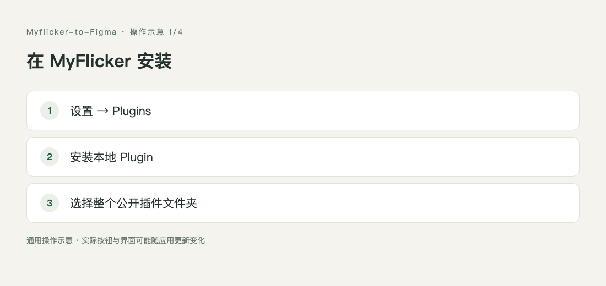
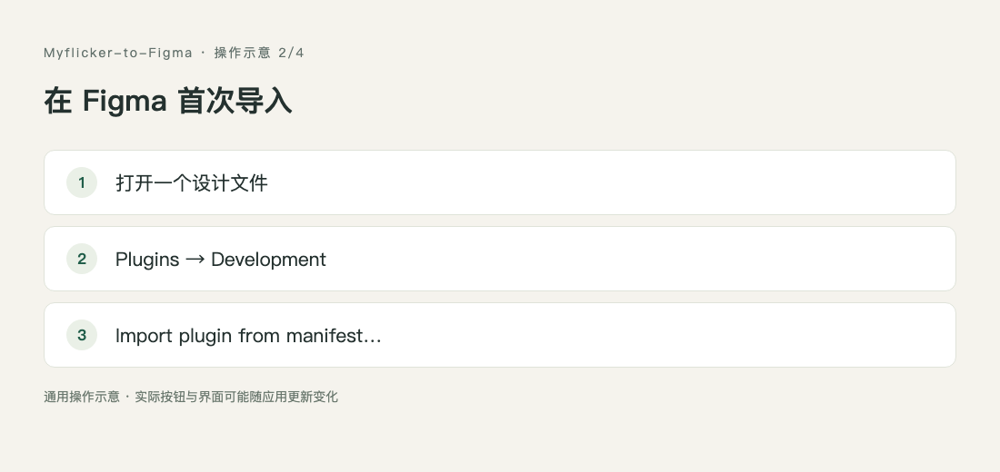
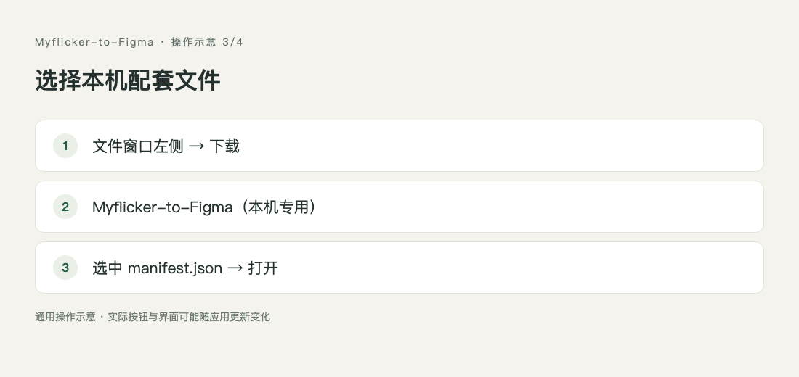
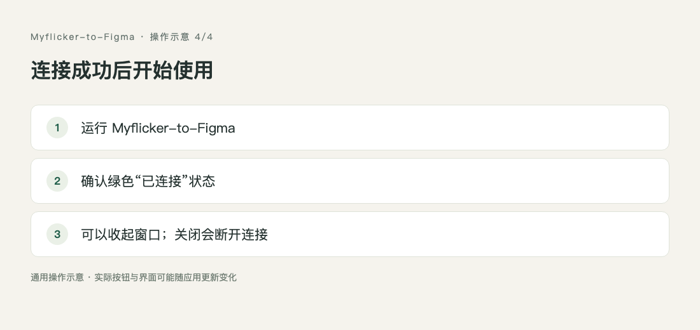

# Myflicker-to-Figma 安装说明

> 版本 0.5.5｜更新 2026-11-12｜macOS 本地试用

## 推荐：通过 GitHub Marketplace 安装

在 MyFlicker 设置 → Plugins → 插件市场 → 管理 Marketplace 中添加：

```text
Josewyx/Myflicker-to-Figma
```

添加后搜索 `myflicker-to-figma` 并安装、启用。旧版先停用，避免工具重复。然后直接继续本文第 3 步。

市场目录需要时手动刷新。添加市场不会替你安装 Figma 端插件；Figma 仍需首次导入本机生成的 manifest。以下为 ZIP 本地安装备用方式。

## 1. 准备

安装并打开 **MyFlicker** 和 **Figma 桌面应用**，然后解压 `Myflicker-to-Figma-0.5.5.zip`。

你会得到 **Myflicker-to-Figma-0.5.5** 文件夹，这个文件夹本身即可安装，里面不再嵌套同名插件文件夹。不要拆开里面的文件。本版不需要双击脚本，也不需要额外安装 CLI、Node.js、npm、Git 或 Xcode。

## 2. 在 MyFlicker 中安装

进入 **设置 → Plugins → 安装本地 Plugin**，选择解压得到的 **Myflicker-to-Figma-0.5.5** 整个文件夹，确认安装并启用。

旧版用户先停用旧版同名插件，避免重复工具。验证新版可用后再卸载旧条目。旧名称可能是 MF to Figma、Local 或 mf-figma-local。



## 3. 获取连接向导

新建一个 **本机/本地执行环境的 Code 会话**，发送：

> 使用 Myflicker-to-Figma 连接本机 Figma，检查状态，并给我连接向导。

首次启动会自动准备离线依赖。打开 AI 返回的向导；如果工具暂未出现，重启 MyFlicker 并新建本地会话。

## 4. 在 Figma 导入

1. 在 Figma 桌面端打开一个有编辑权限的设计文件。
2. 选择 **Plugins → Development → Import plugin from manifest…**。
3. 在文件选择窗口左侧点 **下载**。
4. 打开刚生成的 **Myflicker-to-Figma（本机专用）** 文件夹，选择 `manifest.json` 并点“打开”。以向导显示的名称为准，重名时可能带序号。
5. 在目标设计文件中运行 **Plugins → Development → Myflicker-to-Figma**。





这里选择的是程序在“下载”中新生成的本机专用文件夹，不是最初导入 MyFlicker 的公开文件夹。**不需要复制路径，不要单独移动 manifest.json**，它必须与 code.js、ui.html 放在一起。

## 5. 创建第一个动效画板



向导显示“已连接”后，回到 MyFlicker 发送：

> 使用 Myflicker-to-Figma，在当前文件中新建一个 960×540 的可编辑画板，主题为「Hello Motion」，保留已有设计。先检测原生 Motion 能力；可用时让标题逐字入场、圆形轻轻位移并淡入，制作约 3 秒的动效。完成后给我真实截图，并说明如何预览；若当前环境不支持动效，保留静态画板并说明原因。

Figma 插件窗口可以收起，关闭会断开连接。每个目标文件都需要运行插件。

## 连接自检与恢复

连接向导顶部会显示 **MyFlicker 端版本、Figma 端版本和导入文件状态**。

- **两端版本不同，但协议兼容**：可以继续操作；建议关闭 Figma 插件后重新运行。若 Figma 端版本更高，应更新 MyFlicker 端插件。
- **配套插件较旧，部分工具不可用**：先关闭并重新运行 Figma 插件。仍不行时，点“重新准备导入文件”，再从向导显示的本机专用文件夹重新导入并运行。
- **配套文件不完整**：点“重新准备导入文件”，补齐 manifest.json、code.js、ui.html 后重新导入。
- **尚未收到连接**：先在目标设计文件运行插件；首次使用才需要导入。向导无法仅凭无连接状态区分“未导入”和“未运行”。
- **本地服务无法连接**：回到 MyFlicker 发送“连接本地 Figma”，打开返回的新向导。旧页面无法检查服务停止后的状态。
- **配对失效**：按 Figma 插件中的提示打开新向导，重新准备并导入配套文件。

“重新检查”只刷新状态。“重新准备导入文件”只准备当前电脑的配套文件，不重置密钥、不修改设计、不自动重放操作；有操作执行时需等完成再试。多个文件连接时，版本列表按连接顺序显示；具体目标仍在 MyFlicker 中确认。需要反馈问题时，可以复制不含文件名称、路径和配对凭证的诊断信息，其中包含两端版本与自检状态。

## 排错与清理

- 缺少 `code.js` / `ENOENT`：重新从完整的本机专用文件夹导入，不要用散落的 manifest。
- 加载环境失败：在 Figma 点 **Show/Hide console → Console**，反馈第一条红色报错截图。
- “下载”里尚无文件夹：先完成第 3 步，让 AI 通过本地插件连接。
- 旧版卸载只处理这个插件，普通升级不要手动删除仍在使用的运行和配对数据。

公开 ZIP 可以分享；本机专用文件夹含配对凭证，不要分享。安装成功后可删除原始解压文件夹，但应保留“下载”中的本机专用文件夹。

配图为不含个人数据的操作示意，实际界面可能随 MyFlicker/Figma 更新而变化。
