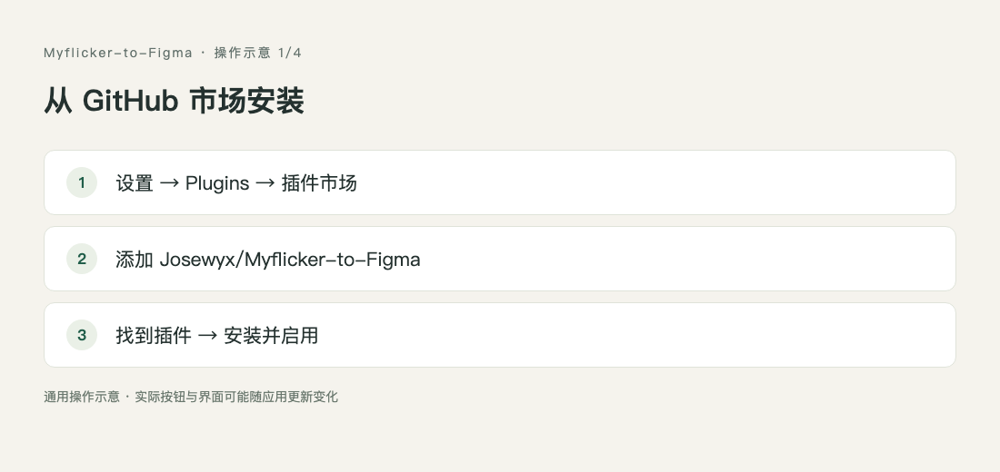
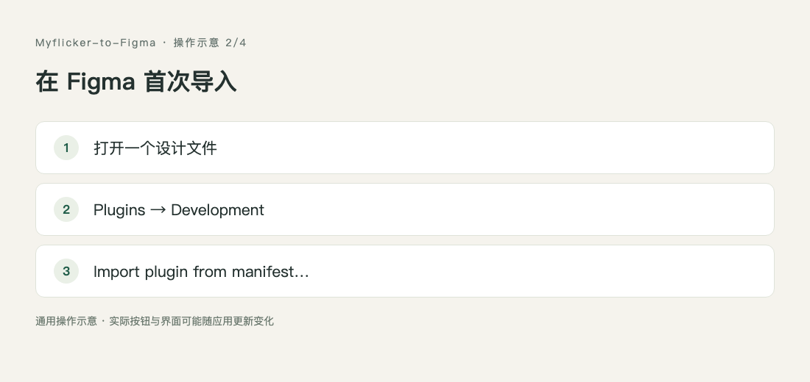
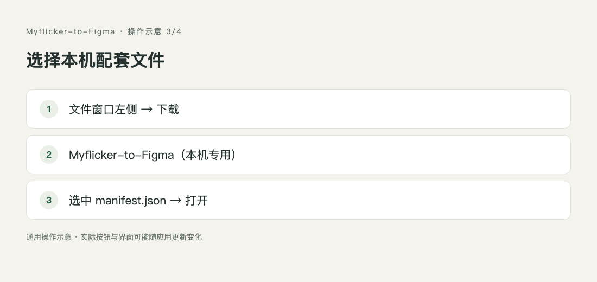
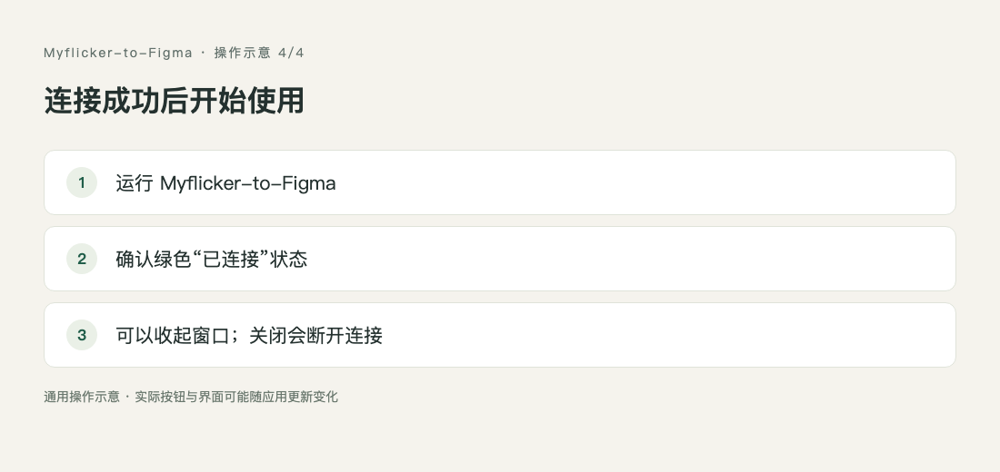

# Myflicker-to-Figma 使用指南

> 版本 0.5.8｜更新 2026-11-13｜macOS 本地使用

Myflicker-to-Figma 让 MyFlicker 用自然语言读取、创建和编辑 Figma 原生设计。免费 Starter 账号在具有文件编辑权限时也可使用；支持当前账号和编辑器实际开放的原生动效，生成的图层可继续编辑。

本项目以 MIT 许可证开源，基于 [Duoasa/DSH-to-Figma](https://github.com/Duoasa/DSH-to-Figma) 改造。项目地址：[Josewyx/Myflicker-to-Figma](https://github.com/Josewyx/Myflicker-to-Figma)。

## 先分清两端

| 安装位置 | 使用什么 | 安装方式 |
| --- | --- | --- |
| MyFlicker | 公开 GitHub 市场中的插件 | 添加市场后，找到插件并安装 |
| Figma | 当前电脑生成的本机专用配套插件 | 首次从“下载”中的 manifest.json 导入 |

**GitHub 市场不会自动安装 Figma 端。** 本项目尚未上架 Figma Community。每台电脑都需自行配对，不要分享本机专用目录。

## 1. 在 MyFlicker 中安装

先安装并打开 MyFlicker 和 Figma 桌面应用。

1. 打开 **设置 → Plugins → 插件市场 → 管理 Marketplace**。
2. 输入下面的市场地址，点击“添加”：

```text
Josewyx/Myflicker-to-Figma
```

3. 看到市场显示“1 个 Plugin”，说明市场添加成功；还需要关闭管理窗口，在插件市场中找到 **myflicker-to-figma**，点击安装并启用。
4. 如果已有旧版，先停用旧版，避免两版同时启用。确认新版正常后再卸载旧条目。



普通安装不需要手动执行 CLI、Git、Node.js、npm 或 Xcode 命令；GitHub 来源的下载能力由 MyFlicker 宿主管理。

## 2. 获取本机连接向导

新建一个 **本机/本地执行环境的 Code 会话**，发送：

> 使用 Myflicker-to-Figma 连接本机 Figma，检查状态，并给我连接向导。

首次启动会自动准备离线依赖。打开 AI 返回的连接向导。若当前会话没识别到工具，重启 MyFlicker 并新建本地会话。

程序会在 **下载** 中生成 **Myflicker-to-Figma（本机专用）** 文件夹。名称重名时可能带序号，以向导显示为准。没有生成时先完成本步，不要去 GitHub 源码里寻找 Figma 导入文件。

## 3. 在 Figma 首次导入并运行

1. 在 **Figma 桌面端**打开一个有编辑权限的设计文件；首次建议空白测试文件。
2. 选择 **Plugins → Development → Import plugin from manifest…**。
3. 文件选择窗口左侧点 **下载**。
4. 打开向导显示的 **Myflicker-to-Figma（本机专用）** 文件夹，选择 **manifest.json** 并点“打开”。
5. 选择 **Plugins → Development → Myflicker-to-Figma** 运行。





这里导入的是本机专用目录里的 manifest，**不是 GitHub 公开插件目录**。不用复制路径，也不要单独移动 manifest.json；它必须和 code.js、ui.html 留在一起。

向导显示“已连接”后可以回 MyFlicker 操作。Figma 插件窗口可以收起，关闭会断开；每个目标设计文件都需要运行插件，首次导入不用每次重复。



## 4. 创建第一个动效画板

回到当前本地 Code 会话，发送：

> 使用 Myflicker-to-Figma，在当前文件中新建一个 960×540 的可编辑画板，主题为「Hello Motion」，保留已有设计。先检测原生 Motion 能力；可用时让标题逐字入场、圆形轻轻位移并淡入，制作约 3 秒的动效。完成后回读图层与关键帧，仅用文字简短说明；不要截图、导出任何文件或回传图片。预览与导出由我在 Figma 中手动完成。

这条体验指令**不截图、不导出视频、不回传图片**，完成后仅用文字简短说明。你可以在 Figma 直接查看新画板；动效播放需在编辑器中自行预览。结构或关键帧回读不等同于播放验收。

## 5. 以后怎么使用

Figma 配套插件仍在运行时，直接向 MyFlicker 的本地 Code 会话描述操作即可，Agent 会静默检查并复用连接，不必先发送“连接 Figma”，也不用再打开向导。若关闭了插件或退出 Figma，在目标文件重新运行 Myflicker-to-Figma 即可；只有缺失文件、配对失效或升级提示需要时才重新导入。多个文件同时连接时，先确认目标文件。断线或任务中断后先检查实际画布，避免重复创建。

## 6. 升级与旧入口清理

**0.5.8 修复了多页面创建与全页组件预加载问题。更新 MyFlicker 端后，请关闭并重新运行 Figma 插件，确认向导两端都显示 0.5.8；旧配套协议会拒绝写入并提示更新。当前会话仍使用旧工具时，新建本地 Code 会话。**


**MyFlicker：** 在“管理 Marketplace”点击本市场右侧刷新图标，再回插件列表更新或安装新版。不是运行中的无感热更新；先等当前操作完成，避免新旧版本同时启用。工具未刷新时重启 MyFlicker 并新建会话。

**Figma：** 关闭旧插件后重新运行，查看向导两端版本。通常不必重新导入；仍旧版、配对失效或文件路径改变时，点向导“重新准备导入文件”，重新从本机专用目录导入并运行。

如果开发菜单中有多个旧入口，进入 **Plugins → Manage plugins… → Development**，找到旧版，点旁边菜单的 **Remove**，然后重新导入当前配套文件。只移除本插件旧入口，不影响已经生成的画板、图层和动效。普通升级不用删除本机配对目录。

## 7. 自检与排错

向导会显示 **MyFlicker 端版本、Figma 端版本和导入文件状态**。

| 提示 | 处理方式 |
| --- | --- |
| 两端版本不同，但协议兼容 | 可以继续操作；建议关闭 Figma 插件后重新运行。若 Figma 端更新，应更新 MyFlicker 端插件 |
| 配套插件较旧，部分工具不可用 | 先关闭再重新运行；仍不行时重新准备文件、导入并运行 |
| 导入文件缺失 / ENOENT / 找不到 code.js | 重新准备文件，从完整本机专用目录导入，不要用散落的 manifest |
| 尚未收到连接 | 先在目标文件运行插件；首次才需导入。仅凭无连接无法区分“未导入”和“未运行” |
| 本地服务无法连接 | 回 MyFlicker 发送“连接本地 Figma”，打开返回的新向导 |
| 配对失效 | 重新准备并导入当前电脑的配套文件，不要使用别人发来的本机专用目录 |
| Figma 加载环境失败 | Show/Hide console → Console，复制第一条红色错误及详情；需要时手动截图错误提示 |

“重新检查”只刷新状态。“重新准备导入文件”不重置密钥、不改设计、不自动重放操作，执行中会拒绝准备。反馈问题可以复制向导诊断信息，包含版本和自检状态，不含文件名称、路径或配对凭证。

## 备用：ZIP 本地安装

从 [GitHub Releases](https://github.com/Josewyx/Myflicker-to-Figma/releases/latest) 下载 `Myflicker-to-Figma-0.5.8.zip`。解压后，在 MyFlicker **设置 → Plugins → 安装本地 Plugin** 选择整个 **Myflicker-to-Figma-0.5.8** 文件夹；不要选择其中的 .claude-plugin、skills 或 Figma manifest。然后从本指南第 2 步继续。

## 隐私与能力边界

公开 GitHub 地址和发行包可以分享；“下载”中的本机专用目录含配对凭证，不要分享，也不要提交生成的 code.js、ui.html 或原始日志。安装后可删除公开解压目录，应保留正在使用的本机专用目录。

插件不消耗官方远程 MCP 调用额度；MyFlicker 模型费用与数据处理按客户端及模型服务规则执行。本地桥接不代表整个 AI 流程完全离线。账号未开放的能力不会因安装本插件而获得。

配图为不含个人数据的通用操作示意，实际界面可能随应用更新变化。

## 交付方式

创建和修改完成后，Agent 回读相关图层、关键帧并简短文字说明，任务即结束。播放预览、视频/GIF/图片等文件导出均由用户在 Figma 中手动完成，不作为 Agent 的验收步骤。
